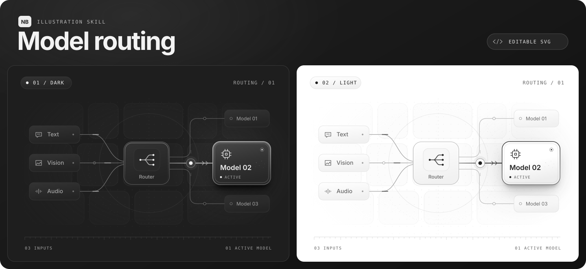
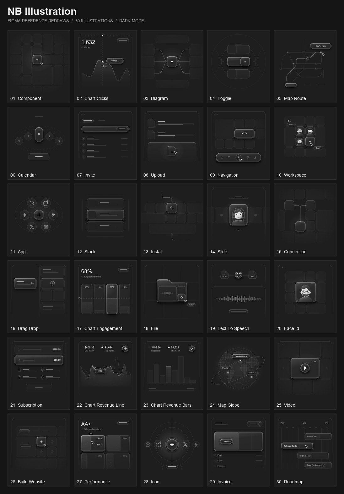
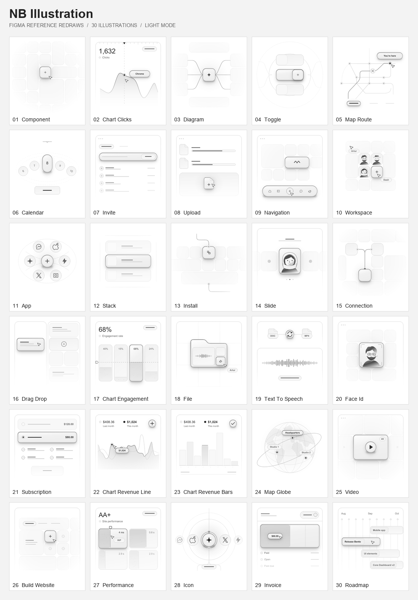

# NB Illustration



把产品功能画成一个正在发生的界面动作。这个 Codex Skill 适合官网功能卡、Bento 网格、技术流程图和界面状态，也可以用来重绘现有插画。

每张图默认交付两份可编辑 SVG。深色版用炭灰底和近白高光，亮色版用纯白底和深石墨色线条。两版共用构图，保留低对比辅助轮廓，并用细边、内沿反光和双层软阴影突出交互焦点。

## 安装到 Codex

### 让 Agent 自动安装

把下面的提示词复制到 Codex 对话中。

```text
请实际安装 NB Illustration Skill。
从 https://github.com/Carlosfengv/nb-Illustration 的 main 分支获取仓库内容。
检查根目录 SKILL.md 的 name 为 nb-illustration，并确认其本地素材齐全。
仅把 SKILL.md、agents/ 和 assets/ 安装到我的用户级 Codex 技能目录 ~/.agents/skills/nb-illustration/。
若该目录已有同名 Skill，保留现有安装并报告检测结果。
完成后检查目标目录，告诉我实际安装路径和调用方式 $nb-illustration。
```

### 手动安装

macOS 或 Linux 可在仓库根目录执行以下命令。

```bash
nb_skill_dir="$HOME/.agents/skills/nb-illustration"
mkdir -p "$nb_skill_dir"
cp -R SKILL.md agents assets "$nb_skill_dir/"
```

用户级安装可跨项目使用。[Codex 技能目录说明](https://learn.chatgpt.com/docs/build-skills#where-codex-loads-local-skills)

## 用法

在 Codex 对话中调用 `$nb-illustration`，给出主题即可。也可以指定画幅、用途，或附上一份要重绘的 SVG。

> 用 $nb-illustration 画一张「模型灰度发布」的官网功能卡，横版 16:9。突出 5% 的流量进入新版本。

默认输出同一构图的 `*-dark.svg` 和 `*-light.svg`。批量生成时每张图各有一对。可以在请求中明确指定只输出一个主题。

## 30 张双主题示例

整套示例来自同一张 Figma 参考画板，沿用原组件编号。每张均为 336 × 336，可编辑 SVG 按主题归档。点击总览可查看大图。[深色 SVG](examples/dark/) · [亮色 SVG](examples/light/)

| 深色总览 | 亮色总览 |
| --- | --- |
| [](examples/previews/nb-illustration-dark.png) | [](examples/previews/nb-illustration-light.png) |

## 仓库内容

- [`SKILL.md`](SKILL.md) 保存绘制规则、主题配色和交付检查。
- [`agents/openai.yaml`](agents/openai.yaml) 定义 Codex 中的显示名和示例提示词。
- [`assets/`](assets/) 保存 Figma 原稿参考和深浅主题样图。
- [`examples/`](examples/) 保存 60 份双主题 SVG 和两张总览图。
